# Информация о репозитории
Репозиторий по выполнение задания. Скриншоты хранятся по принципу создание папки /assets и подтягивание оттуда. Основная часть задания будет выполнена через README файл. Ну и стоит понимать, что многие данные были взяты с интернете, поэтому если вам покажется, что я что-то списал, то вам не покажется(ну и да, не всё я списал, а то, что было повзаиствованно, то я адаптировал под себя). Приятно чтения :>.

# Задание
Выберите предметную область (Ваш вариант – Ваш номер из списка группы) и опишите структуру БД, используя SQL-запросы. К обязательным требованиям относится использование:
1. Объектно-реляционных связей.
2. Ограничений в таблицах.
3. Массивов (дополнить поле в одну из таблиц!).
4. Последовательностей.

А также backup и restore БД для переноса с домашнего ПК.

Результат Вашей работы – отчет. Отчет должен содержать:
1. скриншоты таблиц
2. схему данных
3. SQL-код

## Вариант 13. ГРУЗОВЫЕ ПЕРЕВОЗКИ
Описание предметной области
Вы работаете в компании, занимающейся перевозками грузов. Вашей задачей является отслеживание стоимости перевозок с учетом заработной платы водителей. Ваша компания осуществляет перевозки по различным маршрутам. Для каждого маршрута Вы определили некоторое название, вычислили примерное расстояние и установили некоторую оплату для водителя. Информация о водителях включает фамилию, имя, отчество и стаж. Для проведения расчетов Вы храните полную информацию о перевозках (маршрут, водитель, даты отправки и прибытия). По факту некоторых перевозок водителям выплачивается премия. 
### Таблицы:
- Маршруты (Код маршрута, Название, Дальность, Количество дней в пути, Оплата).
- Водители (Код водителя, Фамилия, Имя, Отчество, Стаж).
- Проделанная работа (Код маршрута, Код водителя, Дата отправки, Дата возвращения, Премия).

# Отчёт
В первую очередь, предоставляю вам схему:


Начнём с подготовки. Стоит, для начала удалить, то что может встретиться при создание БД.

- *Конечно, создаётся отдельная учебная база данных, но мы делаем так, как бы стоило сделать в реальной рабочей среде. Всё же, в рабочих проектов БД, обычно, большие и можно неожиданно встетиться с существующими табличками.*

```SQL
-- 0. Подготовка
DROP VIEW IF EXISTS v_drivers CASCADE;
DROP TABLE IF EXISTS performed_work CASCADE;
DROP TABLE IF EXISTS drivers CASCADE;
DROP TABLE IF EXISTS routes CASCADE;
DROP TYPE IF EXISTS fio_type CASCADE;
DROP SEQUENCE IF EXISTS seq_route_code CASCADE;
DROP SEQUENCE IF EXISTS seq_driver_code CASCADE;
DROP SEQUENCE IF EXISTS seq_work_id CASCADE;
```

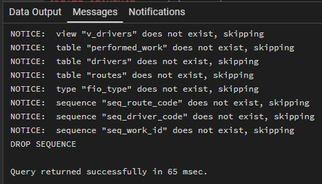

После этого, нужно создать новый тип данных, что бы им можно было заполнять таблицы.

```SQL
-- 1. Объектно-реляционный тип: ФИО
CREATE TYPE fio_type AS (
    last_name   VARCHAR(50),
    first_name  VARCHAR(50),
    middle_name VARCHAR(50)
);
```

А теперь время создания объектов. Нужно для автоматизации ID.

- *Проще говоря, некая замена **id INT GENERATED ALWAYS AS IDENTITY PRIMARY KEY**, но указанная явно.*

```SQL
-- 2. Последовательности
CREATE SEQUENCE seq_route_code
    START WITH 1
    INCREMENT BY 1;

CREATE SEQUENCE seq_driver_code
    START WITH 1
    INCREMENT BY 1;

CREATE SEQUENCE seq_work_id
    START WITH 1
    INCREMENT BY 1;
```

Теперь, время для создание создания таблицы маршрутов.

```SQL
-- 3. Таблица Маршруты
CREATE TABLE routes (
    route_code      INTEGER PRIMARY KEY
                    DEFAULT nextval('seq_route_code'),
    name            VARCHAR(100) NOT NULL UNIQUE,
    distance_km     NUMERIC(8,2) NOT NULL
                    CHECK (distance_km > 0),
    days_on_road    INTEGER NOT NULL
                    CHECK (days_on_road > 0),
    driver_payment  NUMERIC(10,2) NOT NULL
                    CHECK (driver_payment >= 0)
);

ALTER SEQUENCE seq_route_code
    OWNED BY routes.route_code;
```

После этого, идёт таблица водителей.

```SQL
-- 4. Таблица Водители
CREATE TABLE drivers (
    driver_code         INTEGER PRIMARY KEY
                        DEFAULT nextval('seq_driver_code'),
    fio                 fio_type NOT NULL,
    experience_years    INTEGER NOT NULL
                        CHECK (experience_years >= 0 AND experience_years <= 60),
    license_categories  TEXT[] NOT NULL DEFAULT '{}'::TEXT[],

    CONSTRAINT chk_fio_parts CHECK (
        (fio).last_name IS NOT NULL AND (fio).last_name <> '' AND
        (fio).first_name IS NOT NULL AND (fio).first_name <> '' AND
        (fio).middle_name IS NOT NULL AND (fio).middle_name <> ''
    ),

    CONSTRAINT chk_license_categories CHECK (
        license_categories <@ ARRAY['A','B','C','D','E','BE','CE','DE']::TEXT[]
    )
);

ALTER SEQUENCE seq_driver_code
    OWNED BY drivers.driver_code;
```

А теперь, время создания таблицы проделанной работы.

```SQL
-- 5. Таблица Проделанная работа
CREATE TABLE performed_work (
    work_id         INTEGER PRIMARY KEY
                    DEFAULT nextval('seq_work_id'),
    route_code      INTEGER NOT NULL,
    driver_code     INTEGER NOT NULL,
    departure_date  DATE NOT NULL,
    return_date     DATE NOT NULL,
    bonus           NUMERIC(10,2) NOT NULL DEFAULT 0
                    CHECK (bonus >= 0),

    CONSTRAINT fk_work_route FOREIGN KEY (route_code)
        REFERENCES routes(route_code)
        ON UPDATE CASCADE
        ON DELETE RESTRICT,

    CONSTRAINT fk_work_driver FOREIGN KEY (driver_code)
        REFERENCES drivers(driver_code)
        ON UPDATE CASCADE
        ON DELETE RESTRICT,

    CONSTRAINT chk_dates CHECK (return_date >= departure_date),

    CONSTRAINT uq_work_trip UNIQUE (route_code, driver_code, departure_date)
);

ALTER SEQUENCE seq_work_id
    OWNED BY performed_work.work_id;
```

Настало время для тестовых данных.

- *К слову, комментарии в скрипте используются, так как мы делаем что-то похожее на коммерческий уровень, где комментарии являются необходимостью, чтобы не терять время и силы(для понимания, что тут написали).*

```SQL
-- 6. Тестовые данные
INSERT INTO routes (name, distance_km, days_on_road, driver_payment)
VALUES
('Москва - Санкт-Петербург', 710.00, 2, 15000.00),
('Москва - Казань', 820.00, 2, 18000.00),
('Екатеринбург - Новосибирск', 1500.00, 3, 30000.00);

INSERT INTO drivers (fio, experience_years, license_categories)
VALUES
(ROW('Иванов', 'Иван', 'Иванович')::fio_type, 10, ARRAY['B','C','CE']),
(ROW('Петров', 'Пётр', 'Петрович')::fio_type, 5, ARRAY['B','C']),
(ROW('Сидоров', 'Сидор', 'Сидорович')::fio_type, 15, ARRAY['C','CE','D']);

INSERT INTO performed_work
(route_code, driver_code, departure_date, return_date, bonus)
VALUES
(1, 1, DATE '2025-09-01', DATE '2025-09-03', 5000.00),
(2, 2, DATE '2025-09-05', DATE '2025-09-07', 0.00),
(1, 3, DATE '2025-09-10', DATE '2025-09-12', 7000.00);
```

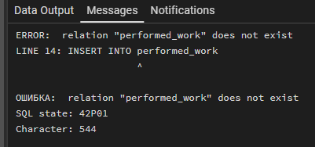

Ах да, я ж таблицу то таблицу то не создал. Да, я написал скрипт, но забыл его использовать... Исправляемся и вводим данные ещё раз.

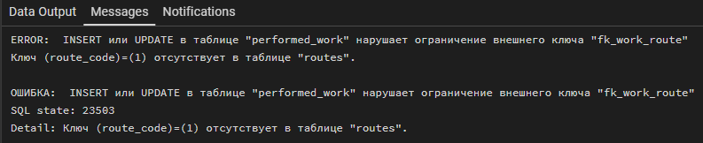

мммммм...


Чтож, проверим, что у нас в табличке то хоть происходит...

```SQL
SELECT * FROM routes;
SELECT last_value, is_called FROM seq_route_code;
SELECT * FROM drivers;
SELECT last_value, is_called FROM seq_driver_code;
```

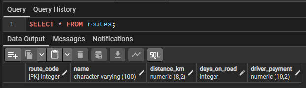

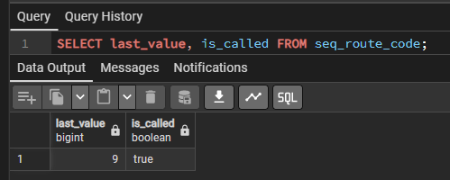

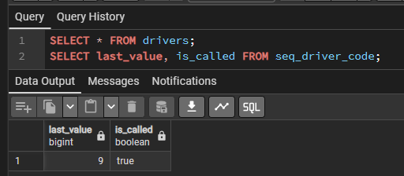

Ах ну да, я ж грубо вставил йидишник... Зачем? Сам не знаю, но время для адекватного кода

```SQL
INSERT INTO performed_work
(route_code, driver_code, departure_date, return_date, bonus)
VALUES
((SELECT route_code FROM routes WHERE name = 'Москва — Санкт-Петербург'),
 (SELECT driver_code FROM drivers WHERE (fio).last_name = 'Иванов'),
 DATE '2025-09-01', DATE '2025-09-03', 5000.00),

((SELECT route_code FROM routes WHERE name = 'Москва — Казань'),
 (SELECT driver_code FROM drivers WHERE (fio).last_name = 'Петров'),
 DATE '2025-09-05', DATE '2025-09-07', 0.00),

((SELECT route_code FROM routes WHERE name = 'Москва — Санкт-Петербург'),
 (SELECT driver_code FROM drivers WHERE (fio).last_name = 'Сидоров'),
 DATE '2025-09-10', DATE '2025-09-12', 7000.00);
```

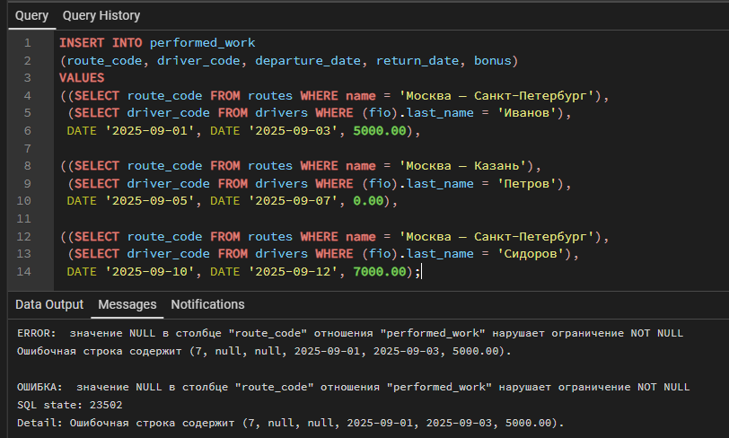

Ага, ясно, понятно. Кажется у меня мозг отказал. Что вообще происходит с этой БД... Хорошо, пробуем проверить таблицы ещё раз.

```SQL
SELECT route_code, name, length(name) AS len FROM routes;
SELECT driver_code, (fio).last_name, length((fio).last_name) AS len FROM drivers;
```

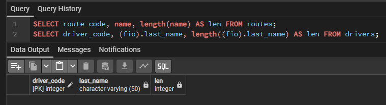

Ага. Ну, хотя бы данные не внеслись в БДэшку. Хотя бы это радует, не придётся удалять или вручную изменять. Чтож, я надеюсь, что проблема же не тире, которые я использовал? Ну да, я любитель большого тире. А что такого? Ладно, время это проверить.

```SQL
SELECT route_code, name
FROM routes
WHERE name LIKE 'Москва%';
```

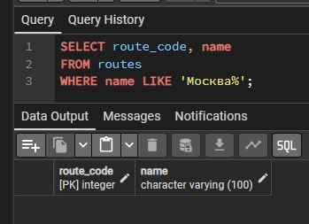

Чтож... Ладно. Продолжаем наше расследование... Перейдём к более логичным действиям, которые стоило сделать сразу. Проверим, есть ли вообще данные в таблицах.

```SQL
SELECT COUNT(*) FROM routes;
SELECT COUNT(*) FROM drivers;
SELECT COUNT(*) FROM performed_work;
```

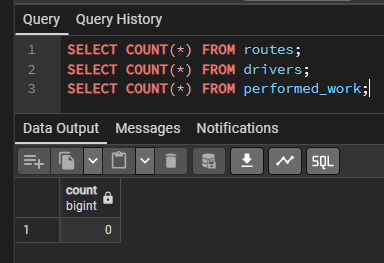

ДА НУ... Я даже данные не вставил... Чтож, видимо быть умным - дело мне не по сильное... Ладно, снова пытаемся сделать запрос

```SQL
INSERT INTO routes (name, distance_km, days_on_road, driver_payment)
VALUES
('Москва — Санкт-Петербург', 710.00, 2, 15000.00),
('Москва — Казань',          820.00, 2, 18000.00),
('Екатеринбург — Новосибирск', 1500.00, 3, 30000.00);
```

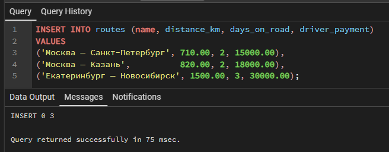

Вы не поверите, но это сработало. Спасибо, пожалуйста... Самое время продолжить

```SQL
INSERT INTO drivers (fio, experience_years, license_categories)
VALUES
(ROW('Иванов',  'Иван',  'Иванович')::fio_type,  10, ARRAY['B','C','CE']),
(ROW('Петров',  'Пётр',  'Петрович')::fio_type,   5, ARRAY['B','C']),
(ROW('Сидоров', 'Сидор', 'Сидорович')::fio_type, 15, ARRAY['C','CE','D']);
```

На этом этапе не возникло проблем, так что идём дальше!

```SQL
INSERT INTO performed_work
(route_code, driver_code, departure_date, return_date, bonus)
VALUES
((SELECT route_code FROM routes  WHERE name = 'Москва — Санкт-Петербург'),
 (SELECT driver_code FROM drivers WHERE (fio).last_name = 'Иванов'),
 DATE '2025-09-01', DATE '2025-09-03', 5000.00),

((SELECT route_code FROM routes  WHERE name = 'Москва — Казань'),
 (SELECT driver_code FROM drivers WHERE (fio).last_name = 'Петров'),
 DATE '2025-09-05', DATE '2025-09-07', 0.00),

((SELECT route_code FROM routes  WHERE name = 'Москва — Санкт-Петербург'),
 (SELECT driver_code FROM drivers WHERE (fio).last_name = 'Сидоров'),
 DATE '2025-09-10', DATE '2025-09-12', 7000.00);
```

И тут мы тоже смогли спокойно всё выполнить! Ну и время сделать представление, чтобы было проще разглядывать итог.

```SQL
-- 7. Представление для удобного осмотра(ну или просмотра)
CREATE OR REPLACE VIEW v_drivers AS
SELECT
    driver_code,
    (fio).last_name   AS last_name,
    (fio).first_name  AS first_name,
    (fio).middle_name AS middle_name,
    experience_years,
    license_categories
FROM drivers;
```

Ну и, как я думаю, стоит отобразить водителей с категорией C(у меня только B :<).

```SQL
-- 8. Проверочные запросы для скриншотиков
SELECT * FROM routes;
SELECT * FROM v_drivers;
SELECT * FROM performed_work;
-- Пример запроса с массивом
SELECT driver_code,
       (fio).last_name AS фамилия,
       license_categories
FROM drivers
WHERE 'C' = ANY(license_categories);
```

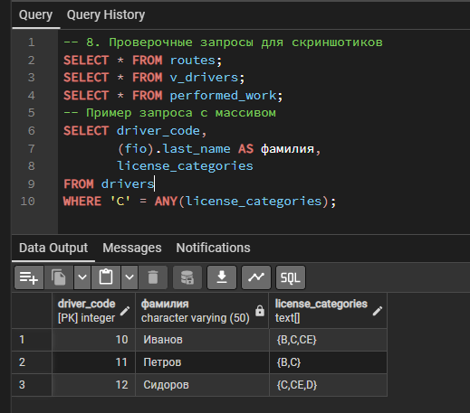

Отлишно, оно работает. Ну и конечно же бэкап.

```Terminal
pg_dump -U postgres -d cargo_transport -F c -f cargo_transport.dump
```