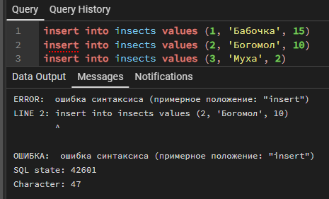
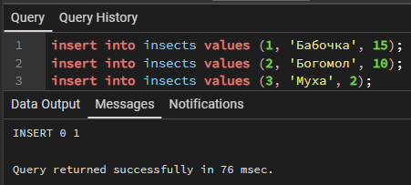
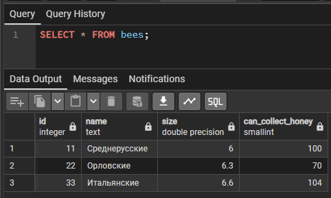
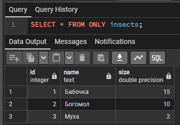

## Без лишних слов
Начнём мы с того, что задание лежит в репозитории в формать *.doc. Не будем терять время и выполним шаги, выданные в задании.

### Задание 1
Выполняем команду:

```sql
CREATE TABLE insects (
	id serial,
	name text,
	size float
);

CREATE TABLE bees (
	can_collect_honey smallint	
) INHERITS (insects);
```

### Задание 2
а теперь вставляем следующий запрос:

```sql
insert into insects values (1, 'Бабочка', 15)
insert into insects values (2, 'Богомол', 10)
insert into insects values (3, 'Муха', 2)
```



О как... Ну да, там же нет точек с запятой. Исправляем!

```sql
insert into insects values (1, 'Бабочка', 15);
insert into insects values (2, 'Богомол', 10);
insert into insects values (3, 'Муха', 2);
```



Ну вот, то что надо!

### Задание 3
Ну, теперь-то я проверю, есть ли ошибка в задании. Ну и да, там тоже пропустили точки с запятой. Запрос:

```sql
insert into bees  values (11, 'Среднерусские', 6.0, 100);
insert into bees  values (22, 'Орловские', 6.3, 70);
insert into bees  values (33, 'Итальянские', 6.6, 104);
```

### Задание 4
Ну, тут всё просто:

```sql
SELECT * FROM bees;
```



### Задание 5
Тут всё аналогично:

```sql
SELECT * FROM insects;
```


### Задание 6
Ну и далее, достоим только родительские данные:

```sql
SELECT * FROM ONLY insects;
```



### Задание 7
А тут уже модификации:

```sql
CREATE TABLE insects2 (
    id serial UNIQUE,
    name text,
    size float
);
```

ну и самое время добавить данные

```sql
insert into insects2 values (1, 'Беброчка', 15);
insert into insects2 values (2, 'Могомол', 10);
insert into insects2 values (3, 'Мухахахаха', 2);
```

### Задание 8
Время для запроса

```sql
CREATE TABLE bees2 (
    can_collect_honey smallint
) INHERITS (insects2);
```

А теперь и данные

```sql
insert into bees2 values (11, 'Среднеусские', 6.0, 100);
insert into bees2 values (22, 'Оловские', 6.3, 70);
insert into bees2 values (33, 'Итальонские', 6.6, 104);
```

Ну так вот, почему же оно отработало и не выдало ошибку? Ответ прост: дочерняя таблица. Всё, что не вставляется в дочернию таблицу, переходит к родителю

### Задание 9
ну и конечно фильтрация запроса

```sql
SELECT * FROM insects WhERE size>3;
```


Ну, результат отличный

### Задание 10
Предпоследний запрос

```sql
SELECT * FROM ONLY insects WhERE size>3;
```


Ого, а это прям результат!

### Задание 11
Ну так, в первом случае берём запрос с родительской таблице, в которую входит и дочерняя, а во втором запрашиваем данные только с родительской таблице, исключая дочернюю