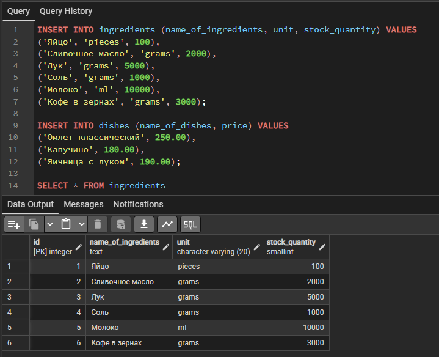
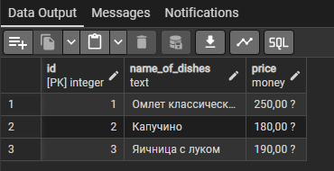
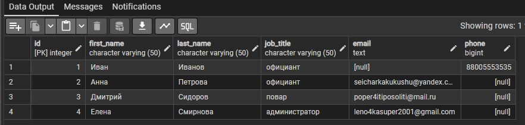
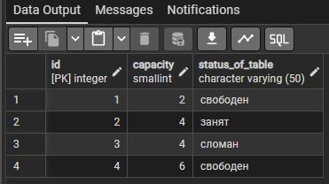
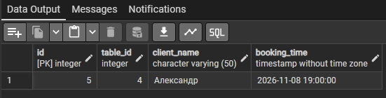
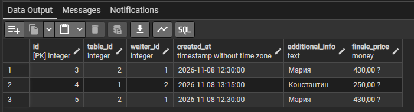
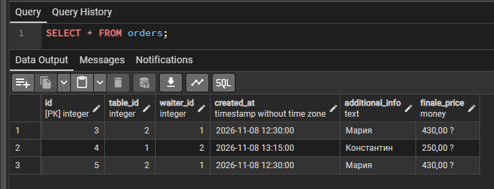
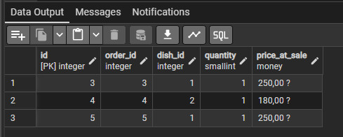
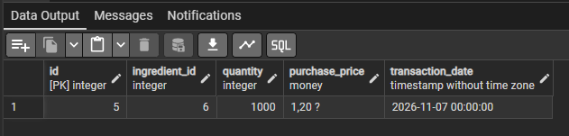
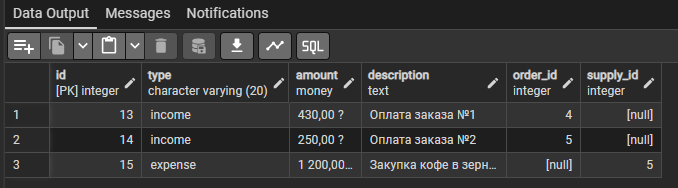

# Домашняя работа: Ресторан.
## Предисловие
Чтож, очередное домашние задание? Да! В этот постараюсь как можно меньше использовать интернета и нейросетей. Всё ж, теории достаточно, а вот практики мало. Ну и в этот раз задание я оставлю не только в самом репозитории, но и пропишу прям здесь. Ну-с, приятного промиотра!

## Задание
### РЕСТОРАН.  
Создаваемая база данных предназначена для учета деятельности ресторана, а именно: движение и учет блюд, ингредиентов, напитков, денег, заказов и пр. 
Блюда ресторана готовятся из ингредиентов.

Например, для приготовления омлета требуется:
    • 1 яйцо 
    • 20 г сливочного масла 
    • 50 г лука 
    • 10 г соли 

Имеется справочник блюд:
    • Наименование блюда
    • Состав (ингредиент, количество, единица измерения)
    • Стоимость

Заказ включает сведения:
    • Дата
    • Клиент
    • Официант
    • Перечень блюд, их количество, цена
    • Общая стоимость заказа

Спроектировать базу данных для учета работы ресторана. 

## Немного слов об задании
Какой кошмар и ужас. Ладно, переживём. Ну-с, тут конечно не так уж много и страшно, но поныть-то хочется ¡-¡. Самое ужасное, что я до сих пор не выучил команды git ._. 

# Реализация задания
## Подготовка
И так, немного подумав, я понял, что тут очень много разных БД придётся делать... За что ¡-¡ ? На этом моменте нужно определиться с тем, какие БД должны быть, а именно: Бухгалтерия, склад, заказы, рецепты, персонал, столы(брони, поломки и т.д.), поставки и календарь(мероприятия, выходные, смены и т.д.). Немного, конечно, накинул много БД, но зато так интереснее. Ну-с, время запускать pgAdmin и стартовать! Вот, к слову, момент с тем, что изначально я ставил PosgreSQL на Debian, но работаю на Windows. Дело в том, что мне влом возиться с неттопом, который лежит в дальнем углу ящика и вся гарнитура к нему раскидана в разных уголках квартиры. Ставить эмулятор я не вижу особо смысла, ведь, а какая разница между работой на разных операционках? Только в приложении, на котором я буду писать.

## SQL запросы. Создание БД.
Начнём с создание таблицы "Персонал", ну и сразу вместе добавил "Стол":
```sql
CREATE TABLE staff {
    id SERIAL PRIMARY KEY,
    first_name VARCHAR(50) NOT NULL, --ну, я надеюсь, что мы не повтречаем какого-нибудь, кто по имени зайдёт за лимиты. Всё ж, оптимизацию никто не отменял
    last_name VARCHAR(50) NOT NULL,
    job_title VARCHAR(50) NOT NULL,
    email TEXT, --ну, тут уж без лимитов, кто ж знает, какой у человека email
    phone SMALLINT
};

CREATE TABLE tables_of_restrourant { --tables зарезервированное слово
    id SERIAL PRIMARY KEY,
    capacity SMALLINT, --полезно для брони
    status_of_table VARCHAR(50) NOT NULL DEFAULT 'free', --увы, но status зарезервированное слово самой PosgreSQL
};
```

И как вы думаете, что произошло? Ошибка! Потому, что я использовал фигурные скобки, вместо обычных. Ну и лищняя запятая в конце, на 13 строчке

```sql
CREATE TABLE staff (
    id SERIAL PRIMARY KEY,
    first_name VARCHAR(50) NOT NULL, --ну, я надеюсь, что мы не повтречаем какого-нибудь, кто по имени зайдёт за лимиты. Всё ж, оптимизацию никто не отменял
    last_name VARCHAR(50) NOT NULL,
    job_title VARCHAR(50) NOT NULL,
    email TEXT, --ну, тут уж без лимитов, кто ж знает, какой у человека email
    phone SMALLINT
);

CREATE TABLE tables_of_restrourant ( --tables зарезервированное слово
    id SERIAL PRIMARY KEY, --тут было бы хорошо использовать SMALLSERIAL, но оставим по стандарту
    capacity SMALLINT, --полезно для брони
    status_of_table VARCHAR(50) NOT NULL --увы, но status зарезервированное слово самой PosgreSQL
);
```

Теперь-то всё работает. Ну, тогда продолжаем. Теперь таблицы "Блюда", "Ингридиенты" и "Рецепты":

```sql
CREATE TABLE dishes (
    id SERIAL PRIMARY KEY,
    name_of_dishes TEXT NOT NULL,
    price MONEY
);

CREATE TABLE ingredients (
    id SERIAL PRIMARY KEY,
    name_of_ingredients TEXT NOT NULL,
    unit VARCHAR(20) DEFAULT 'grams',
    stock_quantity SMALLINT DEFAULT 0
);

CREATE TABLE recipes (
    dish_id INT REFERENCES dishes(id),
    ingridient_id INT REFERENCES ingridients(id),
    quantity TEXT --cколько чего и на что
);
```

Ну и продолжим с "Бронь", "Заказы" и "Содержимое заказа":

```sql
CREATE TABLE bookings (
    id SERIAL PRIMARY KEY,
    table_id INT REFERENCES tables_of_restrourant(id),
    client_name VARCHAR(50),
    booking_time TIMESTAMP
);

CREATE TABLE orders (
    id SERIAL PRIMARY KEY,
    table_id INT REFERENCES tables_of_restrourant(id),
    waiter_id INT REFERENCES staff(id),
    created_at TIMESTAMP DEFAULT NOW(),
    additional_info TEXT, --на случай, если есть какие-то предпочтения
    finale_price MONEY
);

CREATE TABLE order_items (
    id SERIAL PRIMARY KEY,
    order_id INT REFERENCES orders(id),
    dish_id INT REFERENCES dishes(id),
    quantity SMALLINT, --количество порций
    price_at_sale MONEY
);
```

Ну и закончим это всё дело таблицами "Скад" и "общая бухгалтерия":

```sql
CREATE TABLE supplier_transaction (
    id SERIAL PRIMARY KEY,
    ingredient_id INT REFERENCES ingredients(id),
    quantity INT DEFAULT 0,
    purchase_price MONEY NOT NULL,
    transaction_date TIMESTAMP DEFAULT NOW()
);

CREATE TABLE finance_ledger (
    id SERIAL PRIMARY KEY,
    type VARCHAR(20) NOT NULL,
    amount MONEY NOT NULL,
    description TEXT,
    order_id INT REFERENCES orders(id),
    supply_id INT REFERENCES supplier_transaction(id) 
);
```

Бум. Таблицы созданы.

## Заполнение БД данными
Я надеюсь, вы будете не против, если тестовые данные сгенерирует нейросеть. Всё же, это займёт много времени, если делать самому.

```sql
INSERT INTO staff (first_name, last_name, job_title, email, phone) VALUES
('Иван', 'Иванов', 'официант', NULL, 88005553535),
('Анна', 'Петрова', 'официант', 'seicharkakukushu@yandex.com', NULL),
('Дмитрий', 'Сидоров', 'повар', 'poper4itiposoliti@mail.ru', NULL),
('Елена', 'Смирнова', 'администратор', 'leno4kasuper2001@gmail.com', NULL);

INSERT INTO tables_of_restrourant (capacity, status_of_table) VALUES
(2, 'свободен'),
(4, 'занят'),
(4, 'сломан'),
(6, 'свободен');
```

Ошибка... Печально.

```terminal
ERROR:  smallint вне диапазона 

ОШИБКА:  smallint вне диапазона
SQL state: 22003
```

Ну ни бе, ни ме. И как это понимать? Ладно, скорее-всего, виноват номер телефона у Ивана. Значит меняем тип данных.

```sql
ALTER TABLE staff
ALTER COLUMN phone TYPE INT;
```

```terminal
ERROR:  целое вне диапазона 

ОШИБКА:  целое вне диапазона
SQL state: 22003
```

ДА КУДА. Ладно, сам виноват, что на диапозон не посмотрел. Поменяем на BIGINT.

```terminal
INSERT 0 4

Query returned successfully in 72 msec.
```

Как же прекрасно. Только вот, для оптимизации такое не пойдёт и по хорошему, стоило бы поменять на VARCHAR(20), но мы не будем тратить слишком много времени на такое. Пойдём дальше.

```sql
INSERT INTO ingredients (name_of_ingridients, unit, stock_quantity) VALUES
('Яйцо', 'pieces', 100),
('Сливочное масло', 'grams', 2000),
('Лук', 'grams', 5000),
('Соль', 'grams', 1000),
('Молоко', 'ml', 10000),
('Кофе в зернах', 'grams', 3000);

INSERT INTO dishes (name_of_dishes, price) VALUES
('Омлет классический', 250.00),
('Капучино', 180.00),
('Яичница с луком', 190.00);

SELECT * FROM ingredients;
SELECT * FROM dishes;
```




Да, язабыл, что можно сразу же отобразить... Пред*лагаю сразу же взглянуть на предыдущие таблицы

```sql
SELECT * FROM staff;
SELECT * FROM tables_of_restrourant;
```




Продолжаем заполнять данные

```sql
INSERT INTO bookings (table_id, client_name, booking_time) VALUES
(4, 'Александр', '2026-11-08 19:00:00');

INSERT INTO orders (table_id, waiter_id, created_at, additional_info, finale_price) VALUES
(2, 1, '2026-11-08 12:30:00', 'Мария', 430.00),
(1, 2, '2026-11-08 13:15:00', 'Константин', 250.00);

SELECT * FROM bookings;
SELECT * FROM orders;
```




ЧаВо? А почему у меня Мария раздоилась?

Спустя некоторое время пробития нейронок и интернета, я выяснил, что у Марии раздвоение личности, ибо я не могу иначе объяснить происходящее... Ну и ладно, продолжаем.

```sql
INSERT INTO order_items (order_id, dish_id, quantity, price_at_sale) VALUES
(1, 1, 1, 250.00),
(1, 2, 1, 180.00);

INSERT INTO order_items (order_id, dish_id, quantity, price_at_sale) VALUES
(2, 1, 1, 250.00);

SELECT * FROM order_items;
```

```terminal
ERROR:  INSERT или UPDATE в таблице "order_items" нарушает ограничение внешнего ключа "order_items_order_id_fkey"
Ключ (order_id)=(1) отсутствует в таблице "orders". 

ОШИБКА:  INSERT или UPDATE в таблице "order_items" нарушает ограничение внешнего ключа "order_items_order_id_fkey"
SQL state: 23503
Detail: Ключ (order_id)=(1) отсутствует в таблице "orders".
```

А как так-то... Всмысле у меня там ничего нет? Я ж сам своими очами наблюдал сие творение... КАК? Хорошо, проверим кое-что.



Да как так-то... Ладно, просто правим запрос

```sql
INSERT INTO order_items (order_id, dish_id, quantity, price_at_sale) VALUES
(3, 1, 1, 250.00),
(4, 2, 1, 180.00);

INSERT INTO order_items (order_id, dish_id, quantity, price_at_sale) VALUES
(5, 1, 1, 250.00);

SELECT * FROM order_items;
```



Почему оно пропускает первые числа... Что не так с id...

Вскоре я понял, что я до этого запускал код, но приложение зависло, а после я ещё раз нажал на запуск. Оно сработало 2 раза, но не сработало... Что за бред...

Продолжим.

```sql
INSERT INTO supplier_transactions (ingredient_id, quantity, purchase_price, transaction_date) VALUES
(6, 1000, 1.20, '2026-11-07'); --купили 1000г кофе по 1.2 руб за грамм (1200 руб)

INSERT INTO finance_ledger (type, amount, description, order_id, supply_id) VALUES
('income', 430.00, 'Оплата заказа №1', 1, NULL),
('income', 250.00, 'Оплата заказа №2', 2, NULL),
('expense', 1200.00, 'Закупка кофе в зернах', NULL, 1);
```

```terminal
ERROR:  отношение "supplier_transactions" не существует
LINE 1: INSERT INTO supplier_transactions (ingredient_id, quantity, ...
                    ^ 

ОШИБКА:  отношение "supplier_transactions" не существует
SQL state: 42P01
Character: 13
```

... У меня нет слов...

```sql
INSERT INTO supplier_transaction (ingredient_id, quantity, purchase_price, transaction_date) VALUES
(6, 1000, 1.20, '2026-11-07'); --купили 1000г кофе по 1.2 руб за грамм (1200 руб)

INSERT INTO finance_ledger (type, amount, description, order_id, supply_id) VALUES
('income', 430.00, 'Оплата заказа №1', 4, NULL),
('income', 250.00, 'Оплата заказа №2', 5, NULL),
('expense', 1200.00, 'Закупка кофе в зернах', NULL, 5);

SELECT * FROM supplier_transaction;
SELECT * FROM finance_ledger;
```

Ну да, я добавил лищнюю букву... у меня же supplier_transaction, а не supplier_transactions. Ну и id нужно поправить.




Ну и всё. Вроде как всё.

Удачки вам!